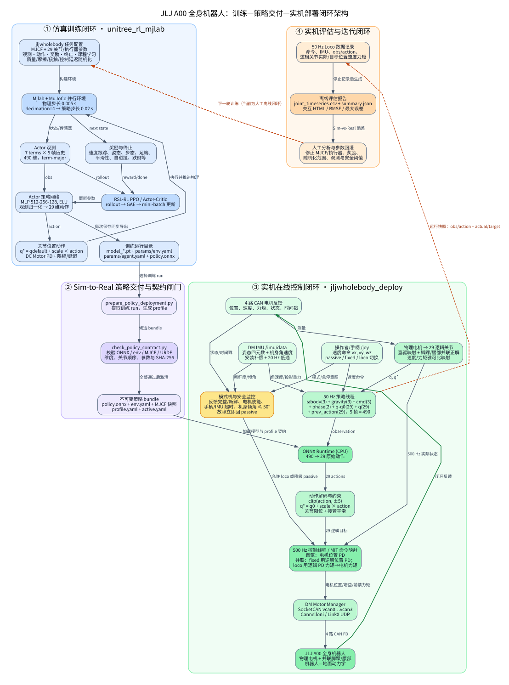

# JLJ A00 全身机器人训练—部署闭环架构



## 架构边界

该图把两个项目串成四层闭环：

1. `/home/rx/project/sliouzhou04/unitree_rl_mjlab` 在 Mjlab/MuJoCo 中完成 `jljwholebody` 速度跟踪策略训练；
2. `prepare_policy_deployment.py` 将训练产物转换成带哈希和完整接口定义的不可变策略 bundle；
3. `jljwholebody_deploy` 以 50 Hz 运行策略、以 500 Hz 闭环控制真实电机；
4. 实机记录与误差报告回到模型、执行器、奖励和域随机化配置，形成下一轮训练迭代。

其中第 1、3 层是程序内实时闭环，第 4 层目前是**人工分析驱动的离线外闭环**，并不是自动在线学习。

## 训练—部署接口契约

| 接口 | 训练侧 | 部署侧 |
| --- | --- | --- |
| 机器人状态 | MuJoCo 29 个逻辑关节 | CAN 电机反馈经直驱映射和并联机构正解得到 29 个逻辑关节 |
| Actor 观测 | 7 个 term、5 帧历史、term-major | 按同一顺序构造，共 `(3+3+3+2+29+29+29)×5 = 490` 维 |
| Actor 动作 | 29 维关节位置动作 | ONNX 输出 29 维，`q* = q_default + action_scale × clip(action)` |
| 策略周期 | `0.005 s × decimation 4 = 0.02 s` | 50 Hz 策略线程 |
| 执行周期 | 仿真 DC Motor PD | 500 Hz MIT 电机命令线程 |
| 直驱关节 | 逻辑关节位置 PD | 逻辑目标直接映射为电机位置 PD |
| 并联关节 | 逻辑 pitch/roll 关节模型 | fixed：逆解到电机位置 PD；loco：逻辑 PD 力矩经雅可比映射为双电机前馈力矩 |
| 策略交付 | `model_*.pt`、`policy.onnx`、`params/env.yaml` | `profile.yaml` 固化关节顺序、默认位姿、action scale、限位、执行器参数及 SHA-256 |

## 当前实现对应关系

- 当前激活训练运行：`unitree_rl_mjlab/logs/rsl_rl/jljwholebody_velocity/2026-09-03_16-48-18`。
- 当前部署选择器：`src/jljwholebody_deploy/config/policies/active.yaml`。
- 在线输入：`/joy`、`/imu/data`、四路 CAN 电机反馈。
- 在线输出：MIT 位置、速度、`Kp/Kd` 和前馈力矩命令。
- 故障降级：反馈缺失/过期、电机未使能、IMU/手柄超时或倾角超限时切回 `passive`。
- 评估输出：`joint_timeseries.csv`、`summary.json` 和离线交互 HTML 报告。

## 可编辑源文件

图的可编辑 Graphviz 源文件为 `system_closed_loop_architecture.dot`。重新生成 SVG/PNG：

```bash
dot -Tsvg docs/system_closed_loop_architecture.dot \
  -o docs/system_closed_loop_architecture.svg
dot -Tpng -Gdpi=180 docs/system_closed_loop_architecture.dot \
  -o docs/system_closed_loop_architecture.png
```
